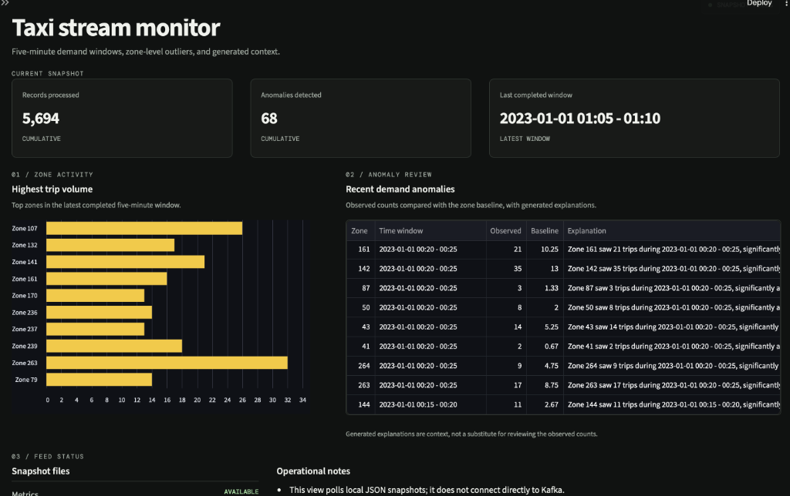
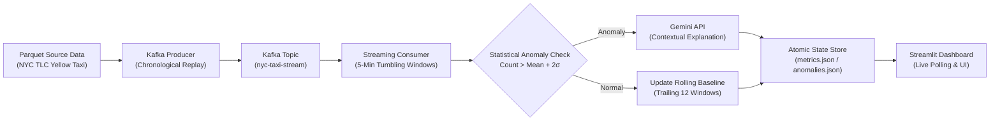

# NYC Yellow Taxi Real-Time Streaming & Anomaly Detection Pipeline

A distributed real-time event streaming pipeline that simulates urban mobility telemetry from NYC Yellow Taxi data, aggregates trip counts over 5-minute tumbling windows, detects demand spikes using rolling statistical baselines, and generates contextual incident explanations via Gemini API.



---

## Architecture Overview



---

## Technical Highlights

- **Event Ingestion & Streaming**: Replays cleaned NYC TLC trip data in chronological order via Apache Kafka (`nyc-taxi-stream`), simulating continuous high-throughput urban telemetry.
- **Tumbling Window Aggregations**: Groups streaming trip records into deterministic 5-minute pickup windows across all active NYC taxi zones (`PULocationID`).
- **Rolling Statistical Baseline**: Maintains a trailing 12-window history (~1 hour) per zone. Flags statistical outliers where demand exceeds `mean + 2 * std` after at least 3 historical baseline windows.
- **Generative AI Root-Cause Context**: Translates statistical anomalies into natural-language operational context via Google Gemini API (`gemini-2.5-flash`), synthesizing time-of-day, location characteristics, and demand spike magnitude.
- **Decoupled Monitoring UI**: Streamlit dashboard reads from an atomic JSON state store, updating key metrics, top-10 pickup zones, and anomaly logs in-place without blocking streaming workers.

---

## Repository Structure

```
nyc-taxi-streaming/
├── .env.example              # Template for environment configuration
├── .gitignore                # Protects secrets and runtime output
├── docker-compose.yml        # Confluent Kafka & Zookeeper configuration
├── requirements.txt          # Python dependencies
├── dashboard_preview.png     # Live monitoring UI capture
├── producer/
│   └── taxi_producer.py      # Streams parquet data to Kafka topic
├── streaming/
│   └── consumer.py           # Windowing, anomaly detection & LLM integration
├── dashboard/
│   └── app.py                # Streamlit real-time monitoring interface
└── data/                     # Ephemeral JSON snapshots (git-ignored)
```

---

## Quickstart

### 1. Prerequisites
- Docker & Docker Compose
- Python 3.9+
- Google Gemini API Key

### 2. Environment Setup
Clone the repository and prepare your environment:
```bash
git clone https://github.com/notparthh0/nyc-taxi-streaming.git
cd nyc-taxi-streaming
cp .env.example .env
```

Edit `.env` with your credentials and local paths:
```ini
GEMINI_API_KEY=your_actual_gemini_api_key
KAFKA_BOOTSTRAP_SERVERS=localhost:9092
KAFKA_TOPIC=nyc-taxi-stream
PARQUET_PATH=/path/to/yellow_tripdata_2023-01.parquet
PRODUCER_SLEEP_SECONDS=0.05
```

Install dependencies:
```bash
pip install -r requirements.txt
```

### 3. Start Kafka & Zookeeper
```bash
docker compose up -d
```
Verify containers are running:
```bash
docker ps
```

### 4. Run the Pipeline

Open three terminal tabs:

**Terminal 1 — Consumer (Window Aggregator & Anomaly Detector):**
```bash
python streaming/consumer.py
```

**Terminal 2 — Producer (Telemetry Streamer):**
```bash
python producer/taxi_producer.py
```

**Terminal 3 — Dashboard (Streamlit UI):**
```bash
streamlit run dashboard/app.py
```

Access the real-time monitor at `http://localhost:8501`.
