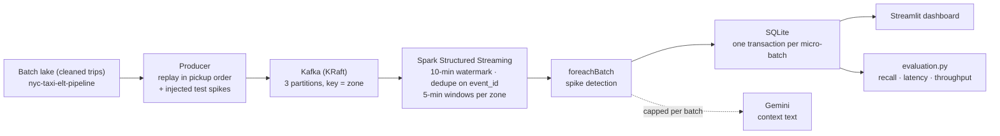

# NYC Taxi Real-Time Demand Spikes


The real-time half of my NYC Taxi Data Platform. The batch half, [nyc-taxi-elt-pipeline](https://github.com/notparthh0/nyc-taxi-elt-pipeline), cleans each month of TLC data into a partitioned Parquet lake. This project replays those cleaned trips through **Kafka** into **Spark Structured Streaming**, which:

- counts trips per pickup zone in 5-minute event-time windows;
- flags demand spikes against each zone's previous hour;
- optionally asks Gemini for plain-language context;
- feeds a live Streamlit dashboard.


---

## Architecture



| Concern | How it's handled |
|---|---|
| **Event time** | Windows use each trip's pickup time, not when the message arrived. |
| **Late data** | A 10-minute watermark: late trips still land in their own window. Trips later than that are dropped, and Spark reports how many (`rows_dropped_by_watermark`). |
| **Duplicates** | The producer may resend messages. Spark deduplicates on `event_id` within the watermark, so duplicate-tracking state doesn't grow forever. |
| **Each window counted once** | Append mode emits a window only when it's final. |
| **Crash recovery** | Kafka offsets and window state live in the Spark checkpoint. Each micro-batch's results are written in **one SQLite transaction together with its batch id**. After a restart, a replayed batch is recognised and skipped, and a half-written one was rolled back, so results are exactly-once. |
| **Spike rule** | `trips > mean + k·std`, `trips > mean + 1` and `trips ≥ 5` over the zone's previous 12 windows (one hour), with quiet windows counted as 0. |
| **LLM cost** | At most 3 Gemini calls per micro-batch. Every failure falls back to a factual sentence, so the stream never waits on or breaks because of the API. |

---

## Results

One full day (Tue 10 Jan 2023) replayed from the batch lake at **2,000 events/s**, with 20 known spikes injected. Measured on a MacBook Air (Nov 2026), Gemini off.

| | Clean run | Killed with `kill -9` mid-run, then restarted |
|---|---:|---:|
| Trips sent → counted | 94,655 → **94,655** | 94,655 → **94,655** |
| 5-minute windows / zone-windows | 288 / 13,219 | 288 / 13,219 |
| Injected spikes caught | **20 / 20** | **20 / 20** |
| Alerts raised | 625 | 625 |
| Window latency p50 / p95 | 3.8 s / 4.7 s | 3.9 s / 8.3 s (restart gap) |
| Rows dropped by watermark | 0 | 0 |

Spark processed about **11,800 rows/s** in micro-batches with a p95 batch time of 0.56 s, so the 2,000 events/s replay left plenty of headroom. The restart run produced the same numbers as the clean run: nothing was lost or counted twice.

**Threshold sweep** (recomputed offline from the stored windows with the same detector code):

| Setting | Spikes caught | Alerts | Injected share of alerts* |
|---|---:|---:|---:|
| k = 2, min 1 trip | 20 / 20 | 1,048 | 1.9% |
| **k = 2, min 5 trips (default)** | **20 / 20** | **625** | 3.2% |
| k = 2.5, min 5 trips | 20 / 20 | 378 | 5.3% |
| k = 3, min 5 trips | 19 / 20 | 227 | 8.4% |

\*A lower bound on precision: alerts on windows I didn't inject aren't all false, because the real data has real surges.

**What the numbers say.** The detector reliably catches sharp spikes, but it raises too many other alerts. Most of them come at 6–8 am, when demand ramps up every weekday: a one-hour rolling baseline treats the normal morning rush as a spike.

My batch-side evaluation study already found the fix. "Same zone, same hour last week" is the strongest demand baseline in this data, so using a seasonal baseline here is the next step. Raising `k` to 3 is the quick trade-off: it cuts alerts by 64% and misses 1 of the 20 spikes.

---

## Run it

Prerequisites: Docker, Python 3.9+, Java 17. You also need one month built by the batch pipeline (`cd ../nyc-taxi-elt-pipeline && make month MONTH=2023-01`).

```bash
pip install -r requirements.txt
make up              # Kafka in Docker, waits until healthy
make experiment      # fresh topic → Spark stream → replay 1 day at 2,000/s with 20 spikes → evaluation
make dashboard       # http://localhost:8501
make test            # 35 tests, no Kafka needed
```

To run the pieces yourself: `make stream` in one terminal and `make produce RATE=1000 DAYS=0.5` in another. Set `GEMINI_API_KEY` in `.env` for AI-generated context on spikes.

The first `make stream` downloads Spark's Kafka connector (one-time, a few MB).

---

## Project structure

```
producer/taxi_producer.py     replay from the batch lake: rate control, event_id, produced_at_ms, spike injection
streaming/spark_stream.py     Spark Structured Streaming job (watermark, dedupe, windows, foreachBatch, checkpoint)
streaming/processor.py        what happens to each micro-batch (no Spark: unit-testable)
streaming/detector.py         the spike rule (pure Python)
streaming/store.py            SQLite store: exactly-once batch commits, zero-filled history
streaming/explain.py          Gemini context with per-batch cap and fallback
streaming/consumer.py         v1: the original single-process Python consumer, kept for comparison
evaluation/evaluate.py        recall on injected spikes, threshold sweep, latency, throughput
dashboard/app.py              Streamlit dashboard (reads data/metrics.json + data/anomalies.json)
tests/                        detector, store/processor (incl. crash + replay), Spark windowing, producer
```

## What changed from v1

v1 was a single Python consumer. It bucketed trips by the window currently open, so a late trip was counted in the wrong window, and it kept the history in memory, so a restart wiped it. Nothing was measured.

v2 moves the windowing to Spark Structured Streaming with event time, a watermark and deduplication, and makes the results exactly-once across restarts. It reads from the batch pipeline's cleaned lake instead of doing its own cleaning, and it measures detection, latency and recovery.

## Limitations

- The rolling one-hour baseline over-alerts on daily ramps (see Results); a seasonal baseline is the next step.
- This is single-node Kafka and local Spark. The design (keyed partitions, checkpointing, idempotent sink) carries over to a cluster, but I have only run it locally.
- Spikes are injected into real data, so recall is measured exactly, but precision on real surges isn't, because there are no labels for those.
