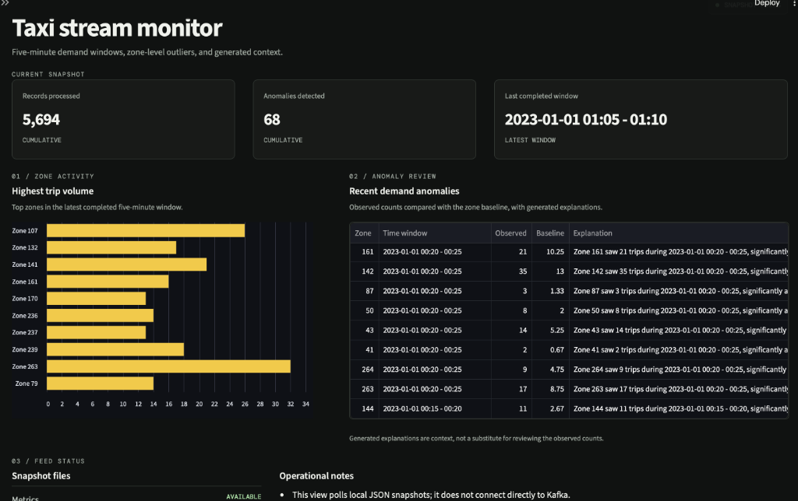
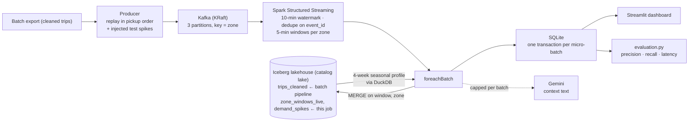

# NYC Taxi Real-Time Demand Spikes


The real-time half of my NYC Taxi Lakehouse Platform. The batch half, [nyc-taxi-elt-pipeline](https://github.com/notparthh0/nyc-taxi-elt-pipeline), cleans every month of TLC data into the Apache Iceberg table `lake.nyc.trips_cleaned`.

This project streams trips through **Kafka** into **Spark Structured Streaming**, which:
- counts trips per pickup zone in 5-minute event-time windows;
- flags demand spikes against a **seasonal baseline read from the batch Iceberg table**;
- writes its results exactly-once into the **same Iceberg lakehouse**;
- can ask Gemini for plain-language context on each spike;
- feeds a live Streamlit dashboard.



---

## Architecture



| Concern | How it's handled |
|---|---|
| **Event time** | Windows use each trip's pickup time, not when the message arrived. |
| **Late data** | A 10-minute watermark: late trips still land in their own window. Trips later than that are dropped, and Spark reports how many (`rows_dropped_by_watermark`). |
| **Duplicates** | The producer may resend messages. Spark deduplicates on `event_id` within the watermark. |
| **Each window counted once** | Append mode emits a window only when it's final. |
| **Exactly-once results** | Kafka offsets and window state live in the Spark checkpoint. Each micro-batch is committed to SQLite in **one transaction with its batch id**, so a replayed batch is skipped. It is also **MERGEd into Iceberg keyed on (window_start, zone)**, so a replay changes nothing there either. |
| **Spike rule (default)** | Seasonal: compare with the same zone, same 5-minute slot and same weekday over the previous 4 weeks of `lake.nyc.trips_cleaned`. Spike if `trips > mean + 3·max(std, √mean, 1)` and `trips ≥ 5`. The √mean term is the Poisson noise floor for small counts. |
| **Baseline rule** | v1 rolling hour: `trips > mean + 2·std` of the zone's previous 12 windows (`--detector rolling`). |
| **LLM** | Gemini (`gemini-3.5-flash-lite`) gets the zone's real name from the TLC lookup (e.g. "JFK Airport (Queens)") plus the observed and usual levels, and returns 1–2 sentences with causes labelled as hypotheses. It makes at most 3 calls per micro-batch, each with a 30 s timeout and no hidden retries. Any failure falls back to a factual sentence, so the stream never breaks because of the API. |

---

## Results

One full day (**Tue 14 Mar 2023**, 101,078 trips) replayed at **1,000 events/s**, with **20 labelled spikes** injected among 13,201 zone-windows. The seasonal profile comes from the 4 previous Tuesdays in the batch Iceberg table. Iceberg sink on, Gemini off, MacBook Air (Nov 2026).

| | Clean run | Killed with `kill -9` mid-run, then restarted |
|---|---:|---:|
| Trips sent → counted (SQLite and Iceberg) | 101,078 → **101,078** | 101,078 → **101,078** |
| Zone-windows in Iceberg `zone_windows_live` | 13,201 | 13,201 |
| Spikes in Iceberg `demand_spikes` | 187 | 187 |
| Window latency p50 / p95 | **4.2 s / 5.2 s** | 4.3 s / 8.7 s (restart gap) |
| Rows dropped by watermark | 0 | 0 |

The restart run ended in exactly the same state as the clean run, in both sinks.

**Seasonal detector vs the rolling-hour rule baseline.** Both were run on the same stored windows with the same code. Precision counts every alert outside the 20 injected spikes as false, so it is a strict lower bound: some of those alerts are real surges.

| Detector | Spikes caught (recall) | Alerts | Precision (strict) | F1 |
|---|---:|---:|---:|---:|
| Rolling hour, k = 2 (v1 rule) | 20/20 (1.00) | 660 | 3.0% | 0.06 |
| Rolling hour, k = 3 | 20/20 (1.00) | 243 | 8.2% | 0.15 |
| Seasonal, k = 2 | 19/20 (0.95) | 564 | 3.4% | 0.07 |
| **Seasonal, k = 3 (default)** | **18/20 (0.90)** | **187** | **9.6%** | **0.17** |
| Seasonal, k = 4 | 17/20 (0.85) | 75 | 22.7% | 0.36 |

**What the numbers say:**
- Against the v1 rule, the seasonal default raises **72% fewer alerts** (187 vs 660) and misses 2 of the 20 spikes. The 6–8 am rush no longer dominates; the busiest alert hours are now afternoons.
- The rolling rule at a stricter k = 3 is a fair competitor (243 alerts, every spike caught), so the gain is real but moderate.
- k = 4 is the best balance if missing 3 in 20 spikes is acceptable.
- All of this is scored on injected labels. On real surges precision isn't measurable here, because no labels exist for them.

**Gemini check** (`make check-gemini`, 14 Nov 2026): 3 of 3 calls succeeded on the three largest spikes of the run, in 1.2–14.3 s each. Answers are saved to `data/gemini_check.json`. Example, for Lincoln Square East (Manhattan) at 23:25 with 40 pickups against a usual 8: *"plausibly caused by the simultaneous letting out of a major performance at Lincoln Center or an unexpected late-night downpour"*. The larger flash models timed out (HTTP 504) for a new key, so the default is the lite model.

An earlier run with the rolling rule only and no Iceberg sink (10 Jan 2023, 2,000 events/s) gave the same exactly-once result after a crash. In that run Spark processed about 11,800 rows/s.

---

## Run it

Prerequisites: Docker, Python 3.9+, Java 17. You also need the batch lakehouse for the replayed month and the 4 weeks before it: `cd ../nyc-taxi-elt-pipeline && make backfill MONTHS="2023-02 2023-03"`.

```bash
pip install -r requirements.txt
make up              # Kafka in Docker, waits until healthy
make experiment      # fresh topic → Spark stream → replay 14 Mar 2023 at 1,000/s with 20 spikes → evaluation
make dashboard       # http://localhost:8501
make test            # 41 tests, no Kafka needed
make check-gemini    # 3 Gemini calls on the run's biggest spikes (needs GEMINI_API_KEY in .env)
```

To run the pieces yourself: `make stream` in one terminal and `make produce RATE=2000 DAYS=0.5` in another. Set `GEMINI_API_KEY` in `.env` for AI-generated context on spikes.

The first run downloads Spark's Kafka and Iceberg connectors (one-time).

---

## Project structure

```
producer/taxi_producer.py     replay from the batch export: rate control, event_id, produced_at_ms, spike injection
streaming/spark_stream.py     Spark Structured Streaming job (watermark, dedupe, windows, foreachBatch, checkpoint)
streaming/processor.py        what happens to each micro-batch (no Spark: unit-testable)
streaming/seasonal.py         seasonal (default) and rolling-hour detectors; profile query over Iceberg
streaming/detector.py         the rolling-hour rule (pure Python)
streaming/lakehouse.py        Iceberg catalog shared with the batch pipeline; MERGE sink
streaming/store.py            SQLite store: exactly-once batch commits, zero-filled history
streaming/explain.py          Gemini context: zone names, timeout, per-batch cap, fallback
evaluation/check_gemini.py    verifies the Gemini path on real spikes and saves the answers
reference/taxi_zone_lookup.csv  official TLC zone names
streaming/consumer.py         v1: the original single-process Python consumer, kept for comparison
evaluation/evaluate.py        precision/recall/F1 per detector, latency, throughput
dashboard/app.py              Streamlit dashboard (reads data/metrics.json + data/anomalies.json)
tests/                        detectors, store/processor (crash + replay), Iceberg MERGE, Spark windowing, producer
```

## How it got here

- **v1** was a single Python consumer. It bucketed trips by whichever window was open (late trips landed in the wrong one), kept history in memory (a restart wiped it), and measured nothing.
- **v2** moved to Spark Structured Streaming with event time, a watermark and deduplication, and made results exactly-once across restarts. It also started replaying from the batch pipeline's cleaned data.
- **v3** (this version) writes into the shared Iceberg lakehouse and replaces the rolling-hour rule with seasonal baselines from the batch history. Detection is now scored with precision, recall and F1 against that rule.

## Limitations

- The default misses 2 of the 20 injected spikes. Both were small compared with that zone's usual week-to-week variation at that time:
  - zone 246 at 16:55: +15 trips against a spread of 6;
  - zone 142 at 22:10: +33 trips against a spread of 19.

  A rule with k = 3 needs about three times the usual spread.
- The Iceberg catalog is a local folder (file-based). MinIO's official images could no longer be pulled when this was built (Nov 2026), so there is no local object store.
- Gemini is called inside the micro-batch. One answer took 14 s in the check, and a slow answer delays that batch (never by more than the 30 s timeout). Moving explanations to a background worker would remove that.
- This is single-node Kafka and local Spark. The design (keyed partitions, checkpointing, idempotent MERGE sink) carries over to a cluster, but I have only run it locally.
